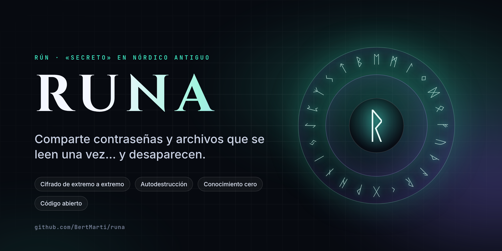
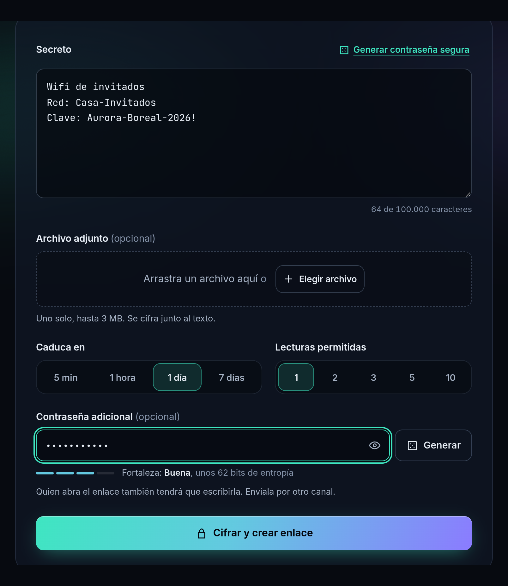
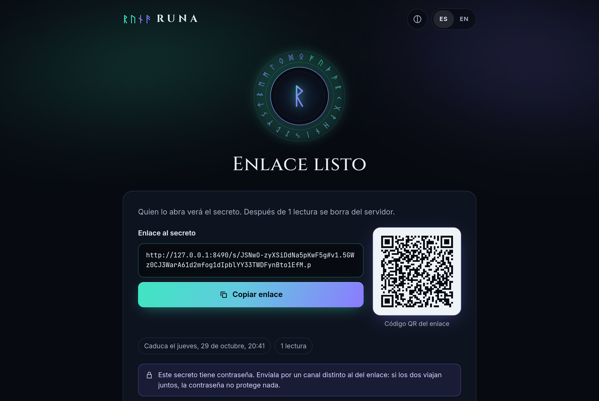
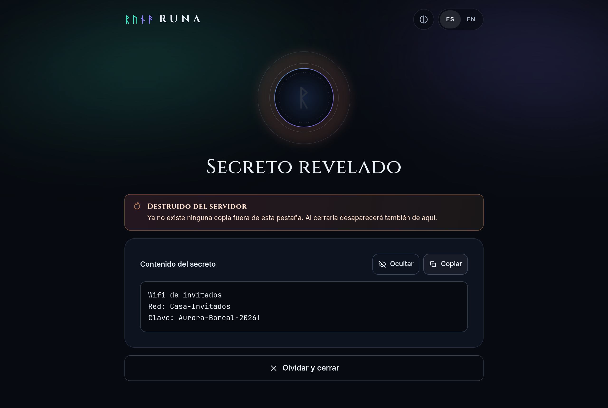
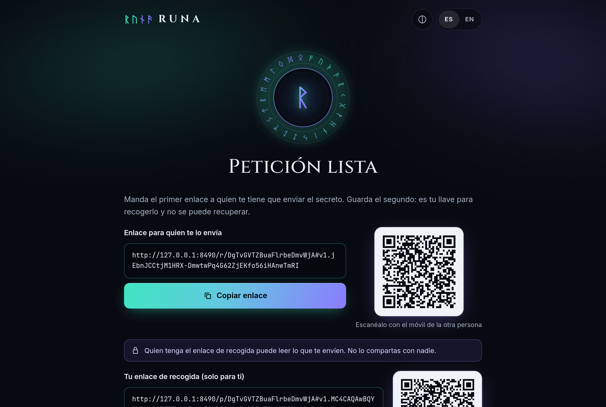
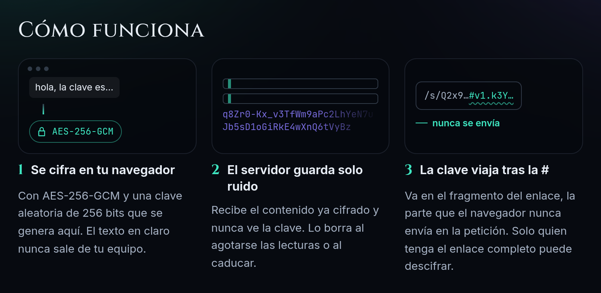
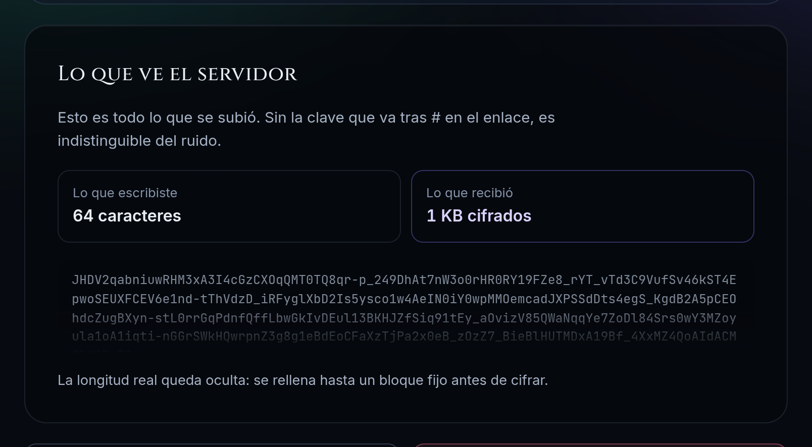
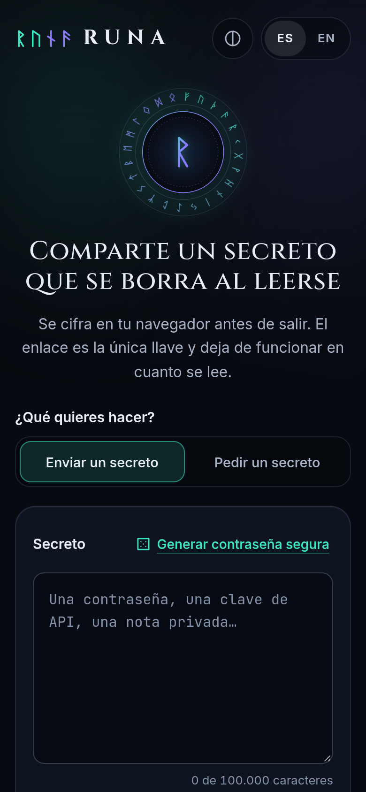
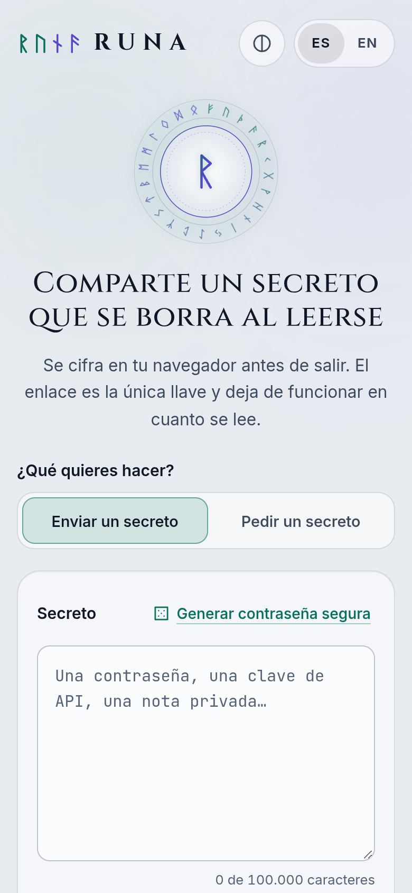

<p align="center">
  
</p>

<p align="center">
  <a href="https://github.com/BertMarti/runa/actions/workflows/ci.yml"></a>
  <a href="https://github.com/BertMarti/runa/actions/workflows/codeql.yml"></a>
  <a href="LICENSE"></a>
  
  
</p>

<p align="center">
  <b>¿Tienes que pasarle a alguien una contraseña, la clave del wifi o un documento privado?</b><br>
  No la mandes tal cual por WhatsApp o por correo, donde se queda guardada para siempre.<br>
  Con <b>RUNA</b> creas un enlace que <b>solo funciona una vez</b>. En cuanto lo abren, el secreto <b>desaparece</b>.
</p>

---

## ✦ Así de fácil

<table>
  <tr>
    <td width="50%" valign="top">
      <h3>1 · Escribe el secreto</h3>
      <p>Pega la contraseña, la nota o arrastra un archivo. Elige cuánto tiempo dura y cuántas veces se puede abrir. Si quieres, ponle además una contraseña.</p>
    </td>
    <td width="50%"></td>
  </tr>
  <tr>
    <td width="50%" valign="top">
      <h3>2 · Comparte el enlace</h3>
      <p>RUNA te da un enlace y un código QR. Cópialo o compártelo por donde quieras: WhatsApp, Telegram, correo o Slack.</p>
    </td>
    <td width="50%"></td>
  </tr>
  <tr>
    <td width="50%" valign="top">
      <h3>3 · Se lee… y se esfuma</h3>
      <p>Quien lo recibe pulsa «Revelar secreto» y lo ve. En ese momento se borra del servidor. Si alguien vuelve a abrir el enlace, solo verá «Este secreto ya no existe».</p>
    </td>
    <td width="50%"></td>
  </tr>
</table>

### ¿Y si eres tú quien necesita recibir un secreto?

Con **«Pedir un secreto»** (nuevo en la versión 0.4) le das la vuelta: RUNA te crea **dos enlaces**.

1. **El enlace de envío** se lo mandas a quien te tiene que pasar la contraseña o el archivo (un cliente, un compañero, tu familia). Lo abre, escribe el secreto y pulsa «Cifrar y enviar».
2. **Tu enlace de recogida** te lo guardas tú. Con él abres lo que te han mandado, una sola vez.

Lo que te envían se cifra en su navegador **para ti**: ni RUNA ni quien vea el enlace de envío pueden leerlo. Así ya no hace falta pedir a nadie que te mande una contraseña por correo.

<p align="center">
  
</p>

---

## ✦ ¿Para qué sirve?

| | |
|---|---|
| 📶 **La clave del wifi** para las visitas, sin dictarla letra a letra. | 🔑 **Contraseñas** de un servicio compartido con tu familia o tu equipo. |
| 💼 **Credenciales** que te pide un cliente o un compañero de trabajo. | 📄 **Un documento delicado** (un contrato, una foto del DNI) que no quieres que se quede en el chat. |
| 🧩 **Claves de programas** o códigos de recuperación. | 🗝️ **Cualquier cosa** que no debería quedarse guardada en una conversación. |

---

## ✦ ¿Por qué es seguro?

Piensa en RUNA como una **caja fuerte con una sola llave**:

<p align="center">
  
</p>

- 🔒 **Se cierra en tu propio dispositivo.** Tu secreto se cifra en tu navegador, antes de salir. Lo que viaja por Internet es un galimatías ilegible.
- 🗝️ **La llave va dentro del enlace**, en la parte que hay detrás del símbolo `#`. Los navegadores **nunca** envían esa parte al servidor. Así que **ni siquiera RUNA puede leer lo que guardas**.
- 🔥 **Se autodestruye.** Cuando se agotan las lecturas o pasa el tiempo elegido (como mucho, 7 días), se borra para siempre.
- 🛡️ **Contraseña opcional con 5 intentos.** Si alguien intercepta el enlace pero no conoce la contraseña, tras 5 fallos el secreto se destruye solo.
- 🤖 **A prueba de vistas previas.** Las apps de mensajería suelen «abrir» los enlaces para mostrar una miniatura. RUNA no gasta la lectura hasta que una persona pulsa «Revelar».
- 🙈 **Sin cookies, sin rastreadores, sin publicidad.** No se guarda tu IP ni qué haces.

<p align="center">
  
  <br><sub>RUNA te enseña lo único que llega al servidor: ruido. Ni siquiera se sabe cuánto mide tu secreto.</sub>
</p>

> 💡 **Consejo:** si pones contraseña, envíala **por otro camino** distinto del enlace. Por ejemplo, el enlace por correo y la contraseña por teléfono.

---

## ✦ Opciones

| Opción | Qué puedes elegir |
|---|---|
| ⏳ **Caducidad** | 5 minutos, 1 hora, 1 día o 7 días |
| 👁️ **Lecturas** | 1, 2, 3, 5 o 10 veces |
| 🔐 **Contraseña extra** | Opcional, con medidor de fuerza y generador |
| 📎 **Archivo adjunto** | Uno, de hasta 3 MB |
| 🎲 **Generar contraseña segura** | Crea una contraseña robusta y lista para enviar |
| 💣 **Destruir ahora** | ¿Te has equivocado de persona? Bórralo antes de que lo abran |
| 🌍 **Idioma** | Español e inglés |
| 🌗 **Tema** | Oscuro, claro («Alba») o el de tu sistema |
| 📲 **Instalable** | Añádela a la pantalla de inicio de tu móvil o a tu ordenador, como una app |

<p align="center">
  
  &nbsp;
  
  <br><sub>Funciona igual de bien en el móvil, de noche o de día.</sub>
</p>

---

## ✦ Preguntas frecuentes

<details>
<summary><b>¿Y si alguien ve el enlace antes que mi destinatario?</b></summary>
<br>
Podría abrirlo, igual que si alguien coge una carta del buzón. Pero tu destinatario se daría cuenta enseguida: le aparecería «Este secreto ya no existe». Para más protección, ponle una contraseña y envíala por otra vía.
</details>

<details>
<summary><b>¿Puede leerlo la persona que gestiona el servidor?</b></summary>
<br>
No. El servidor solo recibe el secreto ya cifrado y nunca recibe la llave. Aunque alguien se llevara el disco entero, solo encontraría datos ilegibles.
</details>

<details>
<summary><b>¿Qué pasa si nadie lo abre?</b></summary>
<br>
Se borra solo cuando llega la fecha de caducidad que elegiste.
</details>

<details>
<summary><b>He abierto el secreto y he cerrado la pestaña sin copiarlo. ¿Lo recupero?</b></summary>
<br>
No. Es justo lo que lo hace seguro: una vez leído, desaparece. Pide a quien te lo envió que cree otro.
</details>

<details>
<summary><b>¿Tengo que crear una cuenta?</b></summary>
<br>
No. No hay cuentas, ni registro, ni correo. Entras, creas el enlace y listo.
</details>

---

## ✦ Tenlo en tu casa

RUNA es **gratis y de código abierto**. Puedes instalarlo en tu ordenador, en un servidor o en una **Raspberry Pi** con un solo comando (necesitas [Docker](https://docs.docker.com/get-docker/)):

```bash
git clone https://github.com/BertMarti/runa.git && cd runa && docker compose up -d
```

Ábrelo en <http://localhost:8484>. Para usarlo desde fuera de casa, sigue la [guía de despliegue](docs/DESPLIEGUE.md). Combina muy bien con [HEIMDALL](https://github.com/BertMarti/HEIMDALL), la VPN para entrar en casa desde fuera.

> 🤖 **¿Usas [ARIA](https://github.com/BertMarti/ARIA)?** RUNA tiene módulo propio: pídele *«comparte la clave del wifi por RUNA»* o *«genérame una contraseña nueva y compártela»* y te devuelve el enlace. Ver `modulos/runa/` en ARIA.

---

## ✦ Para curiosos y técnicos

Si quieres saber cómo funciona por dentro:

| Documento | Qué cuenta |
|---|---|
| [Protocolo criptográfico](docs/PROTOCOLO.md) | Cómo se cifra, qué viaja y qué no |
| [Modelo de amenazas](docs/MODELO_DE_AMENAZAS.md) | Cada ataque que hemos considerado y cómo se frena |
| [Arquitectura](docs/ARQUITECTURA.md) | Piezas del proyecto y decisiones |
| [Despliegue](docs/DESPLIEGUE.md) | HTTPS, variables y endurecimiento |
| [Política de seguridad](SECURITY.md) | Cómo informar de una vulnerabilidad |
| [Hoja de ruta](PLAN.md) | Lo que viene después |
| [Guía para contribuir](CONTRIBUTING.md) · [AGENTS.md](AGENTS.md) | Cómo colaborar, también con agentes de IA |

---

<p align="center">
  <sub><b>RUNA</b> · del nórdico antiguo <i>rún</i>, «secreto, misterio» · hecho por <a href="https://github.com/BertMarti">BertMarti</a> · <a href="LICENSE">licencia MIT</a></sub>
</p>
