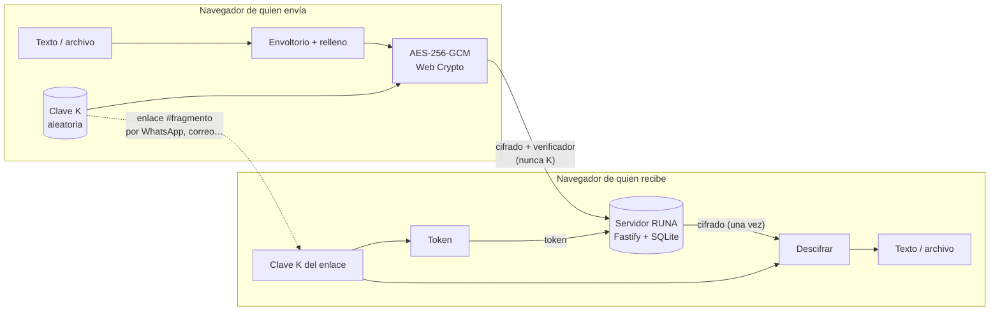

# Arquitectura



## Monorepo

```text
apps/
  server/          API + servidor de la web (Node 24, Fastify 5, node:sqlite)
    src/app.ts       rutas, validación, cabeceras de seguridad, límites
    src/store.ts     almacén SQLite (transacciones, secure_delete)
    src/config.ts    variables de entorno
    src/limits.ts    límites del protocolo (espejo de web/src/crypto/limits.ts)
    test/            tests de API y de almacén (Vitest + fastify.inject)
  web/             SPA (React 19 + Vite 8 + TypeScript)
    src/crypto/      protocolo v1: cifrado, derivación, envoltorio, codificación
    src/screens/     Crear, Resultado, Revelar
    src/components/  piezas de interfaz
    src/i18n/        español e inglés
    test/            tests del protocolo y de la interfaz
docs/              protocolo, amenazas, arquitectura, despliegue
.github/           CI, CodeQL, imagen Docker, Scorecard, Dependabot
```

## Decisiones

| Decisión | Motivo |
|---|---|
| Cifrar en el cliente con Web Crypto | El servidor no puede leer nada; sin librerías criptográficas de terceros que auditar. |
| `node:sqlite` en vez de `better-sqlite3` | Sin código nativo ni scripts de instalación: menos superficie de cadena de suministro y la imagen funciona igual en amd64 y arm64 (Raspberry Pi). |
| SQLite en vez de Redis o Postgres | Un solo contenedor, cero configuración, transacciones atómicas para «leer y descontar». |
| `POST` para abrir (no `GET`) | Los bots de previsualización y el *prefetch* del navegador no lo ejecutan; no se cachea. |
| Un único origen para web y API | La CSP puede ser `'self'` en todo y no hace falta CORS. |
| Imagen distroless | Sin shell ni gestor de paquetes: si alguien entra, no tiene herramientas. |
| Fastify | Validación con JSON Schema integrada y buen rendimiento en una Raspberry Pi. |
| React sin framework de CSS | Control total del diseño y de la CSP (sin estilos en línea generados). |
